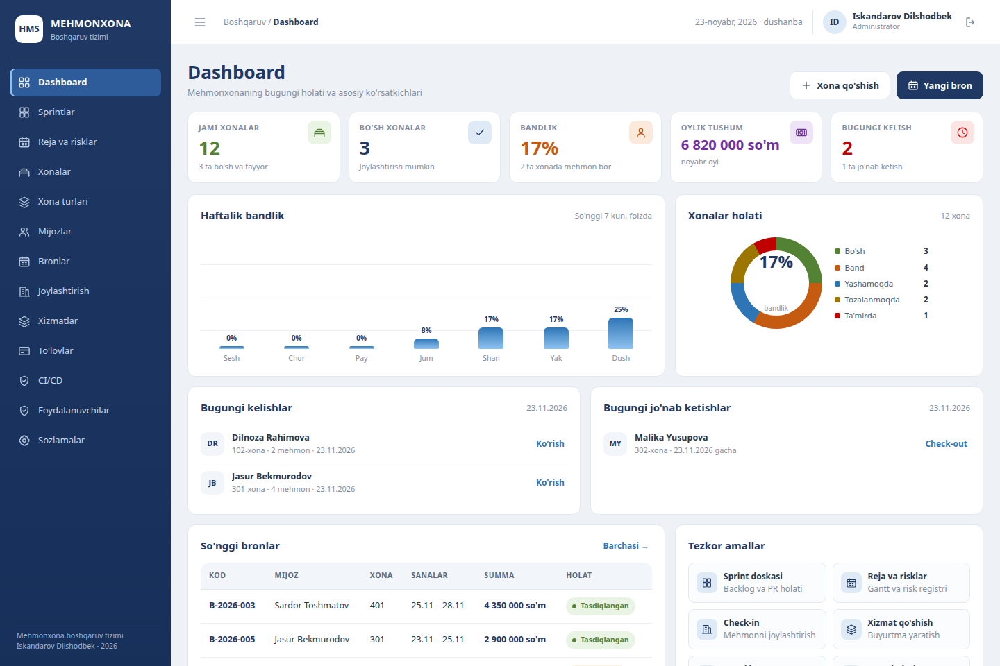
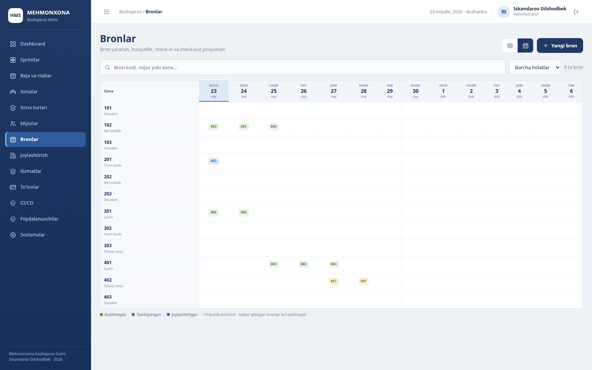
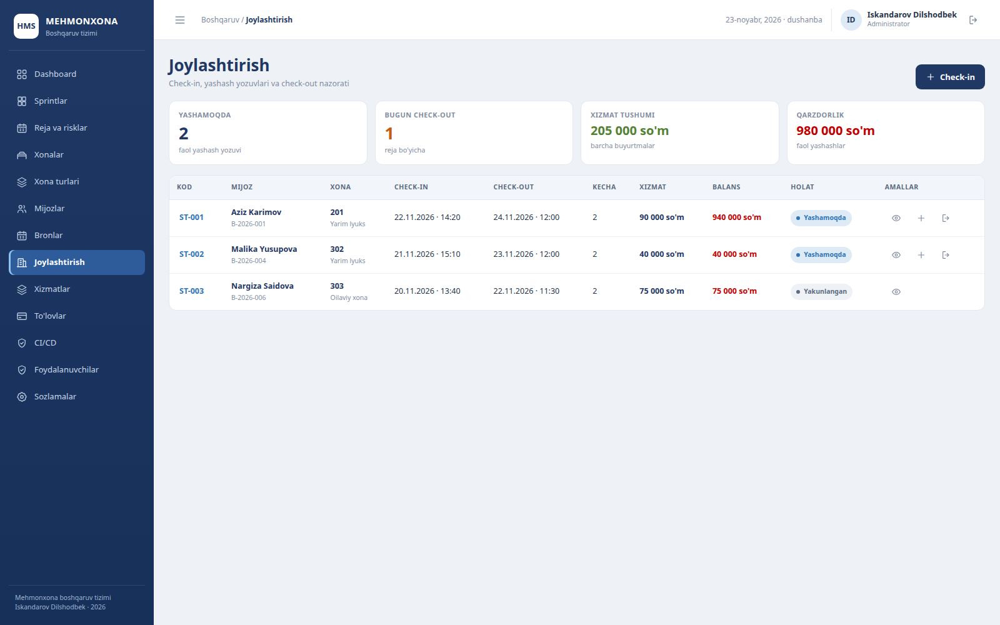
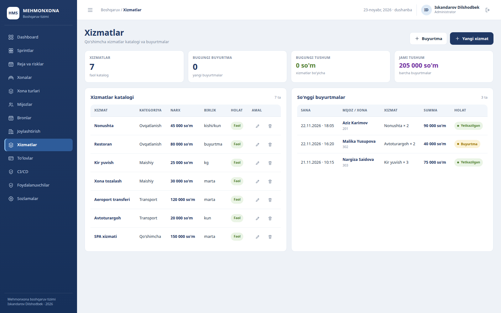
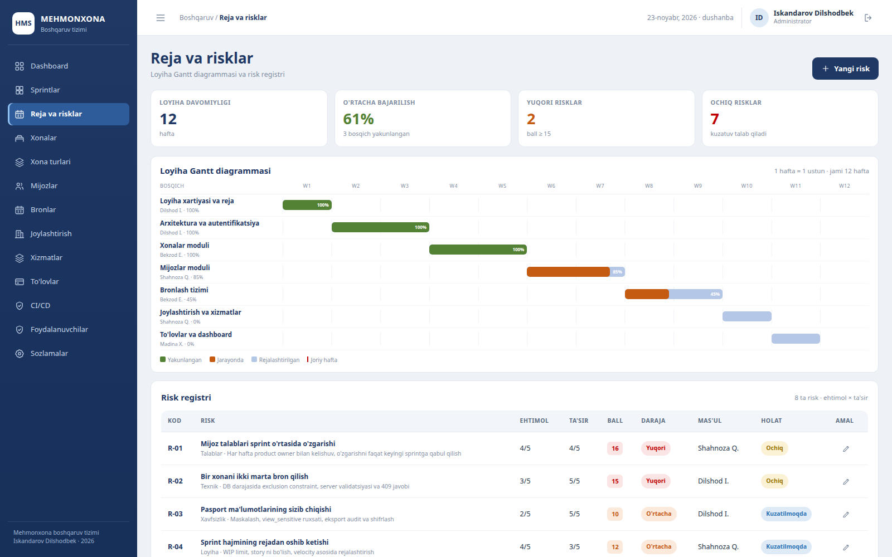
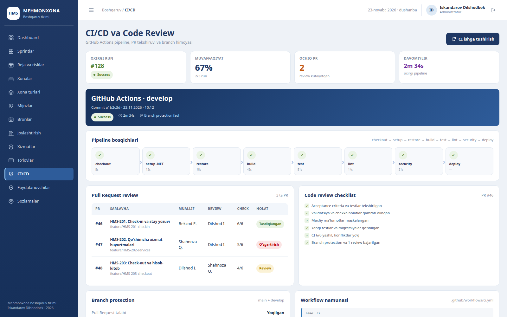

# HMS — Mehmonxona boshqaruv tizimi

Mehmonxona faoliyatini boshqarish uchun **bitta HTML faylda** ishlaydigan demo web ilova. Loyiha HTML, CSS va JavaScript asosida yozilgan; tashqi CDN, backend yoki ma'lumotlar bazasi talab qilmaydi. Barcha ma'lumotlar brauzerning `localStorage` xotirasida saqlanadi.



## Imkoniyatlar

- **Autentifikatsiya va rollar** — Administrator, Menejer, Resepsiyonist, Buxgalter
- **Dashboard** — bandlik, oylik tushum, bugungi kelish va jo'nab ketishlar
- **Xonalar** — CRUD, holat boshqaruvi, qidirish, filtrlash, kartochka ko'rinishi
- **Xona turlari** — narx, sig'im va tavsiflar katalogi
- **Mijozlar** — mijoz kartasi, pasport/ID ma'lumotlari, qidiruv, takroriylikni aniqlash, CSV eksport
- **Bronlar** — mavjudlikni tekshirish, narx hisoblash, tasdiqlash, no-show, bekor qilish
- **Bronlar kalendari** — 14 kunlik bandlik ko'rinishi
- **Joylashtirish** — check-in, check-out, haqiqiy kelish/chiqish vaqti, erta kelish/kech chiqish, qarz bilan chiqish
- **Xizmatlar** — nonushta, restoran, kir yuvish, transfer, parking va boshqa xizmatlar; buyurtmalar va holatlar
- **To'lovlar** — to'lov qayd etish, qoldiq va qarzdorlik nazorati
- **Foydalanuvchilar** — rollar, bloklash/faollashtirish
- **Sprintlar** — Jira uslubidagi backlog va board, story point, PR holati
- **Reja va risklar** — Gantt diagrammasi, risk matritsasi va risk registri
- **CI/CD** — GitHub Actions pipeline, PR review va branch protection ko'rinishi
- **Sozlamalar** — JSON zaxira, import va demo ma'lumotlarni tiklash

## Ekran rasmlari

### Bronlar kalendari



### Joylashtirish va xizmatlar





### Gantt va risk registri



### CI/CD va code review



## Demo hisoblar

| Rol | Login | Parol |
|---|---|---|
| Administrator | `admin@hms.uz` | `admin123` |
| Menejer | `manager@hms.uz` | `manager123` |
| Resepsiyonist | `reception@hms.uz` | `reception123` |
| Buxgalter | `accountant@hms.uz` | `account123` |

## Ishga tushirish

Eng oddiy usul — `index.html` faylini brauzerda ochish.

Yoki lokal server orqali:

```bash
python3 -m http.server 8080
# http://localhost:8080
```

### GitHub Pages

1. Repository → **Settings** → **Pages**
2. **Build and deployment** → **Deploy from a branch**
3. Branch: `main`, folder: `/ (root)`
4. Saqlangach sayt `https://DilshodSoftware.github.io/hotel-management-system/` manzilida ochiladi.

## Loyiha tuzilmasi

```text
hotel-management-system/
├── index.html                 # To'liq ishlaydigan ilova
├── README.md
├── docs/
│   ├── PROJECT_SPEC.md        # Texnik topshiriq
│   ├── Laboratoriya-1.docx
│   ├── Laboratoriya-2.docx
│   ├── Laboratoriya-3.docx
│   ├── Laboratoriya-4.docx
│   └── Laboratoriya-5.docx
└── screenshots/
    ├── dashboard.png
    ├── bookings-calendar.png
    ├── stays.png
    ├── services.png
    ├── gantt-risk.png
    └── ci.png
```

## Hujjatlar

- [Texnik topshiriq](docs/PROJECT_SPEC.md)
- [Laboratoriya 1 — Loyiha xartiyasi va GitHub](docs/Laboratoriya-1.docx)
- [Laboratoriya 2 — User story va Planning Poker](docs/Laboratoriya-2.docx)
- [Laboratoriya 3 — Jira sprint, Git branch va PR](docs/Laboratoriya-3.docx)
- [Laboratoriya 4 — Gantt, risk registri va bronlash](docs/Laboratoriya-4.docx)
- [Laboratoriya 5 — Code Review, CI va joylashtirish](docs/Laboratoriya-5.docx)

## Texnik eslatmalar

- `index.html` — yagona fayl; barcha CSS va JavaScript ichida.
- Ma'lumotlar `localStorage` da saqlanadi; server talab qilinmaydi.
- Demo ma'lumotlarni **Sozlamalar → Demo ma'lumotlarni tiklash** orqali qayta yuklash mumkin.
- Bu o'quv/demo loyihasi: parollar va ma'lumotlar mahalliy brauzerda saqlanadi, ishlab chiqarish (production) uchun mo'ljallanmagan.

## Muallif

**Iskandarov Dilshodbek**  
Abu Rayhon Beruniy nomidagi Urganch davlat universiteti  
Kompyuter injiniring fakulteti · KIDT yo'nalishi · Masofaviy KIDT-236
